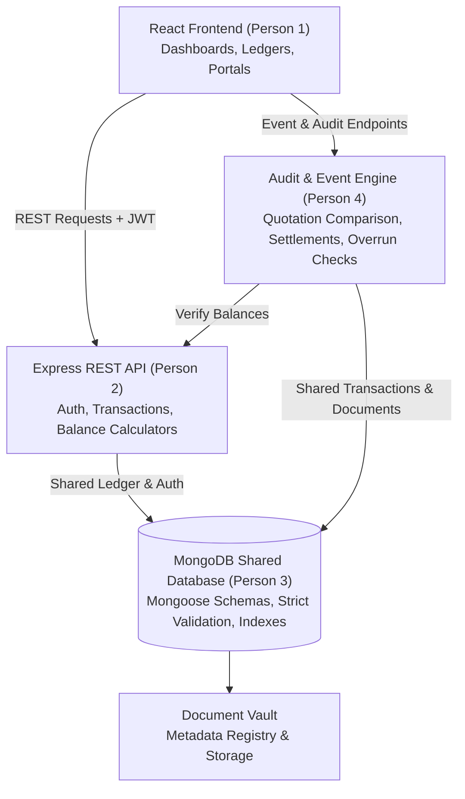

# SocietyLedger — System Architecture & Integration Guide

## 1. Architectural Overview

SocietyLedger is a full-stack MERN application for gated communities and apartment housing societies, engineered for financial integrity, statutory compliance, audit verification, and resident transparency.

## 2. Team Module Integration

| Engineer | Primary Responsibility | Shared Database Dependency | Integration Points |
| :--- | :--- | :--- | :--- |
| **Person 1** | Frontend Development (React) | Consumes all shared models via REST APIs | Renders ledgers, compliance schedules, document viewer, audit observation tracking |
| **Person 2** | Core Backend & Ledgers | Owns Transaction & Fund mutations | Uses `calculateFundBalanceFromTransactions` and shared `Fund`/`Transaction` models |
| **Person 3** | Database & Compliance | Owns Mongoose schemas, compliance models, document metadata, indexes, seed data | Supplies database validation, indexes, sample data, and referential integrity utilities |
| **Person 4** | Events, Audit & Verification | Owns Event settlements, vendor workflows, and verification rules | Uses shared `Event`, `Expense`, `AuditObservation`, `Document`, and `Transaction` models |

---

## 3. Financial Ledger Architecture

SocietyLedger avoids dual-ledger or conflicting balance tracking by strictly observing these rules:
1. **Single Source of Truth**: The `Transaction` collection is the primary authority for all monetary movements.
2. **Double-Entry Formulation**:
   $$\text{Fund Current Balance} = \text{Opening Balance} + \sum \text{Completed Credits} - \sum \text{Completed Debits}$$
3. **Status Isolation**: Only transactions marked `status: 'Completed'` alter fund current balances. `Pending`, `Rejected`, or `Cancelled` transactions are excluded from available funds.
4. **Inter-Fund Transfers**: A transfer records both a source `fund` (debit) and a `destinationFund` (credit), preserving systemic conservation of money.
5. **Masking & Security**: Account numbers and sensitive resident PANs are never transmitted in raw form to unauthorized roles.
