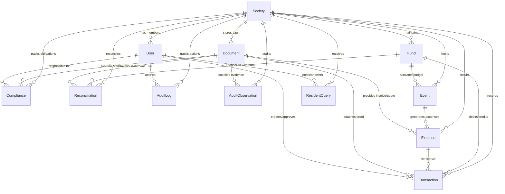

# SocietyLedger — Shared Database Schema & Data Dictionary

## 1. Overview & Data Architecture

SocietyLedger uses **MongoDB** with **Mongoose** as its shared document database layer. All application modules (Authentication, Funds, Transactions, Compliance, Documents, Reconciliations, Audit, Events, Expenses, and Resident Portal) connect to the same unified database.

### Core Principles
1. **Tenant Isolation**: Every record contains an explicit `society` reference (`ObjectId` referencing `Society`), ensuring complete data isolation across apartment societies.
2. **Double-Entry Financial Consistency**: Fund balances are mathematically determined by transaction histories (`openingBalance + credits - debits = currentBalance`). No competing balance stores exist.
3. **Audit Trail & Document Referencing**: Documents, invoices, receipts, and compliance filings are stored as shared metadata records referencing private object keys, never exposing raw cloud credentials or unencrypted paths.
4. **Data Privacy & Security**: Bank account numbers are strictly masked (`XXXXXXXX1234`), passwords are pre-hashed with bcrypt (`$2b$10$...`), and confidential compliance data is restricted by access classification.

---

## 2. Entity-Relationship Diagram



---

## 3. Schema Data Dictionaries

### 3.1 Society Model (`src/models/Society.js`)
Represents the registered gated community or co-operative housing society.

| Field | Type | Required | Constraints / Validation | Description |
| :--- | :--- | :--- | :--- | :--- |
| `_id` | ObjectId | Yes | Auto-generated | Unique identifier |
| `name` | String | Yes | Max 150 chars, trim | Registered society name |
| `code` | String | Yes | Unique, Uppercase, 3-20 chars `^[A-Z0-9_-]{3,20}$` | Short identifier (e.g. `SOC-BLR-001`) |
| `address.street` | String | Yes | Trim | Street address |
| `address.city` | String | Yes | Trim | City |
| `address.state` | String | Yes | Trim | State |
| `address.postalCode` | String | Yes | 6-digit regex `^[0-9]{6}$` | Indian Postal PIN code |
| `address.country` | String | No | Default: `'India'` | Country |
| `contact.email` | String | Yes | Valid email regex | Official society email |
| `contact.phone` | String | Yes | Trim | Society office contact number |
| `registration.registrationNumber` | String | Yes | Trim | Cooperative registrar registration number |
| `registration.registrationDate` | Date | No | Valid Date | Date of society incorporation |
| `registration.authority` | String | No | Default: `'Registrar of Co-operative Societies'` | Regulatory authority |
| `registration.taxIdentifier` | String | No | PAN regex `^[A-Z]{5}[0-9]{4}[A-Z]{1}$` | Society Income Tax PAN |
| `registration.gstin` | String | No | Trim | Goods & Services Tax Identification Number |
| `status` | String | Yes | Enum: `['Active', 'Suspended', 'Inactive', 'Under Formation']` | Operational status (Default: `'Active'`) |
| `settings.financialYearStartMonth`| Number | No | Min 1, Max 12 (Default: `4` - April) | Indian FY starts in April |
| `settings.currency` | String | No | Default: `'INR'` | ISO currency code |
| `settings.verificationRulesEnabled`| Boolean | No | Default: `true` | Automated verification toggle |

**Indexes:**
- `{ code: 1 }` (unique)
- `{ status: 1 }`
- `{ "address.city": 1 }`

---

### 3.2 User Model (`src/models/User.js`)
Represents residents, administrators, treasurers, committee members, and auditors.

| Field | Type | Required | Constraints / Validation | Description |
| :--- | :--- | :--- | :--- | :--- |
| `_id` | ObjectId | Yes | Auto-generated | Unique identifier |
| `name` | String | Yes | Max 100 chars, trim | Full legal name |
| `email` | String | Yes | Unique, Lowercase, valid email | Login username & notification address |
| `password` | String | Yes | Min 6 chars (bcrypt hashed before save) | Salted password hash |
| `phone` | String | No | Trim | Contact mobile number |
| `society` | ObjectId | Yes | Ref: `'Society'` | Associated society membership |
| `role` | String | Yes | Enum: `['Resident', 'Treasurer', 'Committee Member', 'Auditor', 'Society Administrator']` | System access role (Default: `'Resident'`) |
| `unitDetails.flatNumber` | String | No | Trim | Flat / Apartment number (e.g. `A-101`) |
| `unitDetails.wing` | String | No | Trim | Wing / Block name |
| `unitDetails.ownershipType` | String | No | Enum: `['Owner', 'Tenant', 'Non-Resident Owner', 'Office Bearer']` | Tenancy status |
| `accountStatus` | String | Yes | Enum: `['Active', 'Inactive', 'Suspended', 'Pending']` | Account login status (Default: `'Active'`) |
| `lastLogin` | Date | No | Valid Date | Timestamp of last user session |

**Indexes:**
- `{ email: 1 }` (unique)
- `{ society: 1, role: 1 }`
- `{ society: 1, accountStatus: 1 }`

---

### 3.3 Fund Model (`src/models/Fund.js`)
Maintains distinct corpus, operational, emergency, event, and sinking fund allocations.

| Field | Type | Required | Constraints / Validation | Description |
| :--- | :--- | :--- | :--- | :--- |
| `_id` | ObjectId | Yes | Auto-generated | Unique identifier |
| `society` | ObjectId | Yes | Ref: `'Society'` | Owning society |
| `name` | String | Yes | Max 120 chars, trim | Fund title |
| `type` | String | Yes | Enum: `['Corpus fund', 'Maintenance fund', 'Emergency fund', 'Event fund', 'Reserve fund', 'Sinking fund', 'Special Project fund']` | Accounting fund classification |
| `description` | String | No | Trim | Objective and usage guidelines |
| `openingBalance` | Number | Yes | Min 0 (Default: `0`) | Financial year opening balance in INR |
| `currentBalance` | Number | Yes | Double-entry calculation (Default: `0`) | Real-time computed balance |
| `isRestricted` | Boolean| No | Default: `false` | Statutory or AGM spending lock |
| `applicableRestrictions` | Array[String] | No | Array of strings | Specific governance rules / quorum needed |
| `financialYear` | String | Yes | Format `YYYY-YYYY` (e.g. `2025-2026`) | Active financial year |
| `status` | String | Yes | Enum: `['Active', 'Inactive', 'Closed', 'Frozen']` | Fund operational state |
| `bankAccountDetails.bankName` | String | No | Trim | Associated scheduled commercial bank |
| `bankAccountDetails.accountNumberMasked` | String | No | Regex `^X{4,12}[0-9]{4}$` | Masked bank account number for resident safety |
| `bankAccountDetails.ifsc` | String | No | IFSC regex `^[A-Z]{4}0[A-Z0-9]{6}$` | Bank Branch IFSC code |

**Indexes:**
- `{ society: 1, type: 1 }`
- `{ society: 1, status: 1 }`
- `{ society: 1, financialYear: 1 }`

---

### 3.4 Financial Transaction Model (`src/models/Transaction.js`)
All financial credits and debits pass through this model.

| Field | Type | Required | Constraints / Validation | Description |
| :--- | :--- | :--- | :--- | :--- |
| `_id` | ObjectId | Yes | Auto-generated | Unique identifier |
| `society` | ObjectId | Yes | Ref: `'Society'` | Associated society |
| `fund` | ObjectId | Yes | Ref: `'Fund'` | Source/target fund |
| `destinationFund` | ObjectId | Cond. | Required if `transactionType === 'Transfer'` | Destination fund for inter-fund transfers |
| `transactionType` | String | Yes | Enum: `['Contribution', 'Interest', 'Withdrawal', 'Transfer', 'Adjustment', 'Refund', 'Expense Payment', 'Advance']` | Ledger classification |
| `direction` | String | Yes | Enum: `['Credit', 'Debit']` | Double-entry direction |
| `amount` | Number | Yes | Min: `0.01` (strictly positive) | Transaction amount in INR |
| `transactionDate` | Date | Yes | Default: `Date.now` | Value date |
| `description` | String | Yes | Max 300 chars, trim | Narration / purpose |
| `referenceNumber` | String | Yes | Trim | Bank UTR / Cheque / Cheque No. |
| `paymentMethod` | String | Yes | Enum: `['Bank Transfer', 'Cheque', 'NEFT', 'RTGS', 'UPI', 'Debit Card', 'Credit Card', 'Cash', 'Internal Transfer']` | Payment rails |
| `relatedEvent` | ObjectId | No | Ref: `'Event'` | Associated community event |
| `relatedExpense` | ObjectId | No | Ref: `'Expense'` | Associated approved expense |
| `supportingDocuments` | Array[ObjectId] | No | Ref: `'Document'` | Vouchers, receipts, invoices |
| `createdBy` | ObjectId | Yes | Ref: `'User'` | Treasurer / Admin who initiated |
| `approvedBy` | ObjectId | No | Ref: `'User'` | Committee member who approved |
| `status` | String | Yes | Enum: `['Pending', 'Approved', 'Rejected', 'Completed', 'Cancelled']` | Processing state (Default: `'Completed'`) |
| `verificationFlags` | Array[Object] | No | Rule name, notes, timestamp | Automated audit verification findings |

**Indexes:**
- `{ society: 1, transactionDate: -1 }`
- `{ society: 1, fund: 1, transactionDate: -1 }`
- `{ society: 1, status: 1 }`
- `{ society: 1, referenceNumber: 1 }`
- `{ relatedExpense: 1 }`
- `{ relatedEvent: 1 }`

---

### 3.5 Compliance Record Model (`src/models/Compliance.js`)
Tracks statutory, tax, municipal, safety, and labor obligations.

| Field | Type | Required | Constraints / Validation | Description |
| :--- | :--- | :--- | :--- | :--- |
| `_id` | ObjectId | Yes | Auto-generated | Unique identifier |
| `society` | ObjectId | Yes | Ref: `'Society'` | Associated society |
| `complianceCategory` | String | Yes | Enum: `['Tax', 'Statutory', 'Municipal', 'Fire Safety', 'Environmental', 'Labor', 'Audit', 'Governance']` | Statutory domain |
| `complianceType` | String | Yes | Max 150 chars, trim | Specific filing (e.g. `TDS Return Form 26Q`) |
| `financialYear` | String | Yes | Regex `^[0-9]{4}-[0-9]{4}$` | Assessment period |
| `applicablePeriod` | String | Yes | Trim | `Q1`, `Monthly - Oct 2025`, `Annual` |
| `dueDate` | Date | Yes | Valid date | Statutory deadline |
| `responsiblePerson` | ObjectId | Yes | Ref: `'User'` | Assigned officer (Treasurer/Secretary) |
| `assignedRole` | String | No | Enum: `['Treasurer', 'Committee Member', 'Auditor', 'Society Administrator', 'Estate Manager', 'Legal Consultant']` | Assigned role |
| `status` | String | Yes | Enum: `['Upcoming', 'In Progress', 'Pending Review', 'Filed', 'Overdue', 'Correction Required', 'Revised Filing Submitted']` | Filing status (Default: `'Upcoming'`) |
| `submissionDate` | Date | No | Valid date | Actual date submitted |
| `acknowledgementNumber` | String | No | Trim | Government filing acknowledgement reference |
| `challanReference` | String | No | Trim | Tax challan BSR / CIN code |
| `taxLiabilityAmount` | Number | No | Min: `0` (Default: `0`) | Total statutory liability in INR |
| `paidAmount` | Number | No | Min: `0` (Default: `0`) | Amount remitted in INR |
| `supportingDocuments` | Array[ObjectId] | No | Ref: `'Document'` | Filed returns, payment challans |
| `notes` | String | No | Trim | Remarks and advisory notes |
| `revisionHistory` | Array[Object] | No | Sub-schema: date, user, reason, prior status | Audit log of compliance amendments |

**Indexes:**
- `{ society: 1, status: 1, dueDate: 1 }`
- `{ society: 1, complianceCategory: 1 }`
- `{ society: 1, financialYear: 1 }`
- `{ dueDate: 1 }`
- `{ responsiblePerson: 1, status: 1 }`

---

### 3.6 Document Metadata Model (`src/models/Document.js`)
Shared digital vault for invoices, receipts, bank statements, and quotations.

| Field | Type | Required | Constraints / Validation | Description |
| :--- | :--- | :--- | :--- | :--- |
| `_id` | ObjectId | Yes | Auto-generated | Unique identifier |
| `society` | ObjectId | Yes | Ref: `'Society'` | Associated society |
| `originalFilename` | String | Yes | Trim | Original file name |
| `documentCategory` | String | Yes | Enum: `['Invoice', 'Receipt', 'Bank Statement', 'Tax Document', 'Compliance Acknowledgement', 'Vendor Quotation', 'Purchase Order', 'Audit Evidence', 'Minutes of Meeting', 'Other']` | Classification |
| `mimeType` | String | Yes | Trim (e.g. `application/pdf`, `image/png`) | File format |
| `fileSize` | Number | Yes | Min: `0` | Size in bytes |
| `storageProvider` | String | Yes | Enum: `['local', 's3', 'gcs', 'azure', 'mock_secure_storage']` | Storage back-end |
| `storageKey` | String | Yes | Trim (never exposed unrestricted) | Internal vault key / path |
| `relatedEntityType` | String | No | Enum: `['Transaction', 'Compliance', 'Event', 'Expense', 'Reconciliation', 'AuditObservation', 'Fund', 'Society', 'None']` | Polymorphic parent type |
| `relatedEntityId` | ObjectId | No | Valid ObjectId | Linked record ID |
| `uploadedBy` | ObjectId | Yes | Ref: `'User'` | User who uploaded the file |
| `uploadDate` | Date | No | Default: `Date.now` | Upload timestamp |
| `accessClassification` | String | Yes | Enum: `['Public', 'Resident', 'Committee', 'Confidential', 'AuditorOnly']` | Access privilege (Default: `'Committee'`) |
| `verificationStatus` | String | No | Enum: `['Pending', 'Verified', 'Rejected', 'Flagged']` | Verification status (Default: `'Pending'`) |
| `checksum` | String | No | SHA-256 hex string | Hash for duplicate invoice / tampering detection |

**Indexes:**
- `{ society: 1, documentCategory: 1 }`
- `{ society: 1, relatedEntityType: 1, relatedEntityId: 1 }`
- `{ society: 1, verificationStatus: 1 }`
- `{ checksum: 1 }`
- `{ uploadedBy: 1 }`

---

### 3.7 Reconciliation Record Model (`src/models/Reconciliation.js`)
Reconciles bank passbook balances with the SocietyLedger system ledger.

| Field | Type | Required | Constraints / Validation | Description |
| :--- | :--- | :--- | :--- | :--- |
| `_id` | ObjectId | Yes | Auto-generated | Unique identifier |
| `society` | ObjectId | Yes | Ref: `'Society'` | Associated society |
| `fund` | ObjectId | Yes | Ref: `'Fund'` | Bank-linked fund |
| `statementPeriod.startDate` | Date | Yes | Valid date | Period start date |
| `statementPeriod.endDate` | Date | Yes | Valid date | Period end date |
| `statementPeriod.label` | String | No | Trim | Friendly label (e.g. `May 2025 Bank Reconciliation`) |
| `openingBalance` | Number | Yes | Number in INR | Bank statement starting balance |
| `closingBalance` | Number | Yes | Number in INR | Bank statement ending balance |
| `statementBalance` | Number | Yes | Number in INR | Final figure on bank statement |
| `systemCalculatedBalance`| Number | Yes | Number in INR | Balance as computed by system ledger |
| `differenceAmount` | Number | Yes | Computed: `statementBalance - systemCalculatedBalance` | Variance in INR |
| `reconciliationStatus` | String | Yes | Enum: `['Draft', 'In Progress', 'Reconciled', 'Discrepancy Detected', 'Approved']` | Status |
| `supportingDocuments` | Array[ObjectId] | No | Ref: `'Document'` | Bank statement PDF / e-passbook |
| `unreconciledItems` | Array[Object] | No | Sub-schema: transaction ref, description, amount, reason | Outstanding cheques, transit delays |
| `preparedBy` | ObjectId | Yes | Ref: `'User'` | Treasurer who drafted |
| `reviewedBy` | ObjectId | No | Ref: `'User'` | Auditor / Committee member signoff |

**Indexes:**
- `{ society: 1, fund: 1, "statementPeriod.startDate": -1 }`
- `{ society: 1, reconciliationStatus: 1 }`
- `{ preparedBy: 1 }`

---

### 3.8 AuditLog & AuditObservation Models
- **AuditLog (`src/models/AuditLog.js`)**: Tracks user and system mutations (`CREATE`, `UPDATE`, `DELETE`, `APPROVE`, `RECONCILE`, `FLAG`, etc.) with IP address, correlation ID, timestamp, and change summaries.
- **AuditObservation (`src/models/AuditObservation.js`)**: Structured findings filed by internal or statutory auditors. Categories: `Duplicate Invoice`, `Missing Evidence`, `Budget Overrun`, `Unapproved Expense`, `Statutory Non-Compliance`, `Reconciliation Variance`, `Policy Violation`. Severities: `Low`, `Medium`, `High`, `Critical`. Statuses: `Open`, `Under Investigation`, `Action Required`, `Resolved`, `Closed`, `False Positive`.

---

### 3.9 Event & Expense Models
- **Event (`src/models/Event.js`)**: Community gatherings, festivals, AGMs, and maintenance drives. Stores approved budget, actual expense total, and settlement status (`Pending`, `Partially Settled`, `Settled`).
- **Expense (`src/models/Expense.js`)**: Itemized vendor procurement. Distinguishes `requestedAmount`, `approvedAmount`, `advanceAmount`, `paidAmount`, and `refundAmount`. Links to vendor quotations, tax invoices, and payment transactions.

---

### 3.10 ResidentQuery Model (`src/models/ResidentQuery.js`)
Enables the Resident Transparency Portal. Residents post questions on published statements, event expenses, or audit observations; treasurers and committee members reply with verified evidence links.

---

## 4. Development Seed Data Execution

The seed script generates a high-volume, fully interconnected fictional development dataset matching all specification targets:

| Entity | Target Count | Seeded Count | Status |
| :--- | :---: | :---: | :---: |
| Societies | 8 | 8 | Passed |
| Users | 400 | 400 | Passed |
| Funds | 40 | 40 | Passed |
| Financial Transactions | 3,000 | 3,000 | Passed |
| Compliance Records | 240 | 240 | Passed |
| Document Metadata | 600 | 600 | Passed |
| Bank Reconciliations | 100 | 100 | Passed |
| Audit Logs | 1,500 | 1,500 | Passed |
| Audit Observations | 150 | 150 | Passed |
| Events | 120 | 120 | Passed |
| Expense Requests | 300 | 300 | Passed |
| Resident Queries | 200 | 200 | Passed |

### Running the Seed Script
```bash
# Verify dataset in-memory and perform math consistency checks
npm run seed:verify

# Dry-run seed generation without writing to database
npm run seed:dry-run

# Insert full dataset into live MongoDB (configured in .env)
npm run seed

# Reset and fresh-seed live MongoDB
npm run seed:reset
```

### Development Logins
All seeded users have password: `Society@123`.
- Society 1 Admin: `user.soc-blr-001.1@societyledger.local`
- Society 1 Treasurer: `user.soc-blr-001.2@societyledger.local`
- Society 1 Auditor: `user.soc-blr-001.6@societyledger.local`
- Society 1 Residents: `user.soc-blr-001.7@societyledger.local` to `.50`
